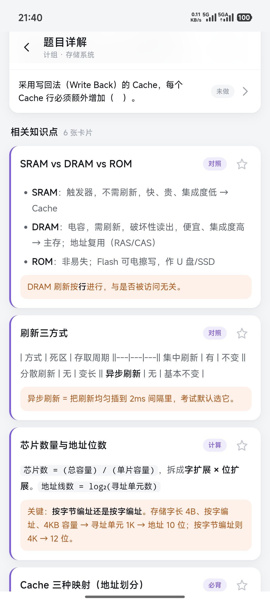

# 研途 408 · 考研刷题 & 速背

一个**完全离线**的安卓考研学习 App：刷题 + 速背。不联网、不申请网络权限，所有答题记录只存在手机本地。

<p align="center">
  
</p>

**快速开始**：下载 [`dist/kaoyan-408.apk`](dist/kaoyan-408.apk)（84 KB，Android 5.0+），传到手机点开安装即可。

两个入口：

| 入口 | 内容 |
|---|---|
| **模拟题练习** | 二级页面选科目 → 408 综合 / 计组 / 数据结构 / 操作系统 / 计网 / 高数一 → 按章节刷题，即时判分 + 知识点解析 |
| **知识点速查 · 速背** | 六科分章的速背卡片，支持翻卡模式、全文搜索、收藏 |

界面按学习通一类校园学习 App 的版式做：顶部导航 + 卡片式功能入口 + 科目/章节列表 + 答题卡抽屉 + 成绩环。

---

## 一、装到手机上（推荐）

**成品：`dist/kaoyan-408.apk`（80 KB）**

1. 把 APK 传到手机（微信/QQ 发给自己、数据线、网盘都可以）
2. 点开安装。系统提示「未知来源应用」时选择**允许安装**
3. 桌面上会出现「研途 408」图标

> 签名用的是本地自签名证书，所以会弹「未知来源」，这是正常现象。
> App **不申请任何网络权限**，不联网、不上传，所有答题记录只存在手机本地。

支持 Android 5.0（API 21）及以上。

---

## 二、不想装 APK 也能用

- **手机浏览器**：把 `dist/kaoyan-408.html` 复制到手机，用浏览器打开即可（单文件，双击就开）
- **电脑预览**：

  ```bash
  node tools/serve.mjs
  # 打开 http://127.0.0.1:8080
  ```

  电脑上按 `F12` 切到手机视图（390×844）看效果最接近真机。

---

## 三、内容规模

共 **208 道题**、**117 张速背卡片**：

| 科目 | 题量 | 速背卡 | 章节 |
|---|---:|---:|---:|
| 数据结构 | 41 | 28 | 8 |
| 计算机组成原理 | 42 | 25 | 7 |
| 操作系统 | 41 | 22 | 8 |
| 计算机网络 | 40 | 19 | 6 |
| 高等数学（一） | 44 | 23 | 8 |
| **合计** | **208** | **117** | **37** |

- **408 综合**不是单独题库，而是按真实卷面配比（数据结构 12 / 计组 12 / 操作系统 9 / 计网 7，共 40 题）**动态组卷**，每次抽到的题都不一样。
- 计组部分沿用了工作区里 `408-review/_extracted/计组真题分类.txt` 的真题考点，其中 2021 年第 16 题、2022 年第 16 题（Cache 行位数、8 路组相联比较器）按原题还原。
- 高数部分按历年数学一真题的题型与难度整理（极限/中值定理/重积分/级数/微分方程等高频题型）。
- 每道题都带**解析**，写清考的是哪个点、易错在哪。

---

## 四、功能清单

**练习**
- 整卷练习 / 按章节练习，二级科目选择页
- 单选即时判分、多选需提交判定，选项绿红高亮
- 每题解析、正确答案、所属章节标签
- 答题卡抽屉（对/错/已选/未做四色标记，可跳题、可交卷）
- 结果页：圆形正确率、答对/答错/用时、错题逐条回顾
- 错题自动进错题本，卡片里直接显示**完整选项**（正确项标绿、你选错的项标红），不用点开就能复盘
- **点任意一道错题进入「题目详解」**：可以重新作答、看解析，下面接着列出**同章节的同类题**和**本章知识点速背卡片**——一道错题就能把这块内容串起来复习
- 错题可单条移除（答对后点「已掌握」）、可整体清空
- 计时器、题目进度条

**速背**
- 按章节浏览卡片，重点标「必背 / 高频 / 易错」
- **翻卡模式**：一次一张、可打乱，适合考前快速过
- 全文搜索（标题 + 正文），跨章节命中
- 卡片收藏，收藏夹集中复习

**其它**
- 深色 / 浅色 / 跟随系统三种主题
- 首页考研倒计时、今日题量、今日正确率、待巩固错题数
- 「我的」里各科进度条与累计统计
- 记录全部存 `localStorage`，退出不丢

---

## 五、目录结构

```
kaoyan-app/
├─ dist/
│  ├─ kaoyan-408.apk         ← 装这个（80 KB）
│  └─ kaoyan-408.html        ← 或这个（单文件离线版，205 KB）
├─ web/                      前端源码
│  ├─ index.html             外壳（data-*.js 由构建脚本内联）
│  ├─ app.css                设计系统与所有组件样式
│  ├─ app.js                 路由 / 渲染 / 答题 / 速背 / 存储
│  ├─ data-core.js           科目元信息与章节定义
│  ├─ data-ds.js             数据结构题库 + 卡片
│  ├─ data-co.js             计算机组成原理
│  ├─ data-os.js             操作系统
│  ├─ data-cn.js             计算机网络
│  └─ data-math.js           高等数学（一）
├─ android/                  安卓壳工程（无第三方依赖）
│  ├─ AndroidManifest.xml
│  ├─ version.json           版本号唯一来源（构建时注入 APK 与页面里）
│  ├─ keystore/              固定签名证书，**勿删**（删了就无法覆盖升级）
│  ├─ src/com/kaoyan/app/MainActivity.java
│  ├─ res/                   字符串 + 矢量图标
│  └─ assets/kaoyan.html     由构建脚本自动同步
└─ tools/
   ├─ build.mjs              合并 web/ → dist/kaoyan-408.html
   ├─ build-apk.mjs          用 aapt2/javac/d8/zipalign/apksigner 打出 APK
   ├─ check-all.mjs          题库与卡片的结构校验
   ├─ smoke-test.mjs         jsdom 端到端交互测试
   ├─ serve.mjs              本地预览服务器
   ├─ fetch-sdk.mjs          下载 build-tools / platform 到 .sdk
   └─ patch-ds.mjs           数据结构题库的一次性校正脚本
```

---

## 六、改动后怎么重新构建

构建链路**不依赖 Gradle、不依赖 Android Studio**，只需要 JDK 17 和一个 Android SDK 的 `build-tools` + `platform`。
`.sdk/`（371 MB）里已经下好了，删掉的话运行 `node tools/fetch-sdk.mjs` 会重新拉。

```bash
# 1. 改完 web/ 里的内容后，先合并成单文件
node tools/build.mjs

# 2. 校验数据结构（章节归属、答案范围、缺解析等）
node tools/check-all.mjs

# 3. 端到端交互测试（需要 npm i jsdom）
node tools/smoke-test.mjs

# 4. 重新打 APK
node tools/build-apk.mjs
```

`build-apk.mjs` 的七个步骤：`aapt2 compile` → `aapt2 link` → `javac` → `d8` → 写入 dex → `zipalign` → `apksigner`。

---

## 七、版本号与签名

**版本号只有一个来源：`android/version.json`**

```json
{ "code": 3, "name": "1.0.03", "note": "本次改了什么" }
```

- `name` 按 `1.0.xx` 递增（01、02、03…），显示在「我的 → 关于」里
- `code` 是整数，每次发版**必须比上一版大**，否则安卓不允许覆盖安装
- 改完这一处，`tools/build.mjs` 会把版本注入页面、`tools/build-apk.mjs` 会写进 APK 的 `versionCode / versionName`，不需要动别的地方

**签名证书固定在 `android/keystore/kaoyan.keystore`**（口令都是 `android`）。

这个文件千万别删——安卓靠签名判断是不是同一个应用，证书一换，新包就装不上去，只能卸载重装。

> 早期几版因为证书是临时生成、每次构建都换，签名不稳定。从 v1.0.03 起证书已固定，**之后的版本都可以直接覆盖安装升级**。

---

## 八、说明

- 内容用于个人复习自测，题型按 408 统考与数学一的考查方式整理，**不是官方真题库**；个别题目的表述与年份标注以公开资料为准，介意的话可以只当练手。
- 想加题：在 `web/data-<科目>.js` 里照格式追加对象即可（`ch` 填章节 id、`ans` 填正确选项下标数组、多选就放多个下标），然后重跑上面四步。
- 想换配色：改 `web/app.css` 顶部 `:root` 里的 `--brand` 等变量。
